<picture>
  <source media="(max-width: 600px)" srcset="assets/cabecera-movil.svg">
  
</picture>

Hola, soy Javi. Estudio Administración de Sistemas Informáticos en Red (ASIR) en el IES San Sebastián, en Huelva. Lo que aprendo en clase lo pongo en práctica en casa, y si algo se puede automatizar, lo hago. Busco prácticas de FP del 3 al 31 de mayo de 2027, en Huelva o cerca.

### En qué estoy

<picture>
  <source media="(prefers-color-scheme: dark)" srcset="assets/estado-oscuro.svg">
  
</picture>
 

- [El homelab](https://jdsantana.com/homelab): un mini PC con Debian que filtra la publicidad de toda la casa y me avisa al móvil si algo cae. En la web explico [por qué he decidido cada cosa](https://jdsantana.com/homelab/decisiones).
- [jdsantana.com](https://jdsantana.com): mi web, con el CV y una bitácora de cada sesión, también de lo que falla. Tiene A+ en Mozilla Observatory.
- [vtscan](https://github.com/Mafallout/virustotal-folder-scanner): revisa una carpeta de Windows con VirusTotal y ordena los archivos de más a menos peligroso. Tiene ventana y se descarga en un zip con el .exe.
- Infraestructura personal: lo que uso a diario, con dominio propio, alias de correo, dos llaves FIDO2 y VPN en todos mis dispositivos.

### Últimas entradas de la bitácora

<!-- BLOG-POST-LIST:START -->
- 03/11/2026: [Home Assistant y repaso de seguridad](https://jdsantana.com/bitacora/home-assistant-y-repaso-de-seguridad)
- 31/10/2026: [Docker, vigilancia y nombres propios con Caddy](https://jdsantana.com/bitacora/docker-vigilancia-y-caddy)
- 25/10/2026: [DNS cifrado y un DNS de respaldo en el router](https://jdsantana.com/bitacora/dns-cifrado-y-respaldo)

<!-- BLOG-POST-LIST:END -->

### Con qué trabajo

| Área | Lo que uso |
| --- | --- |
| Sistemas | Debian sin entorno gráfico, systemd, LVM, SSH, Docker y Git |
| Red y DNS | AdGuard Home, DNS sobre HTTPS y sobre TLS, Tailscale, UFW, Caddy y Cloudflare |
| Copias y vigilancia | restic con almacenamiento compatible con S3, Uptime Kuma, Prometheus, Grafana y Healthchecks |

Ahora estoy con Home Assistant. También he usado Python, SQL, HTML y XML.

Me puedes escribir a [contacto@jdsantana.com](mailto:contacto@jdsantana.com).

English

Hi, I'm Javi. I study Network and Systems Administration (ASIR, a Spanish vocational degree that takes two years) at IES San Sebastián in Huelva, Spain. What I learn in class I put into practice at home, and if something can be automated, I automate it. I'm looking for a vocational training internship from 3 to 31 May 2027, in or near Huelva.

- [The homelab](https://jdsantana.com/homelab): a mini PC running Debian that blocks ads for the whole house and alerts my phone if something goes down. On my website I explain [the reasons behind each decision](https://jdsantana.com/homelab/decisiones) (in Spanish).
- [jdsantana.com](https://jdsantana.com): my website, with my CV and a log of every session, failures included. It scores A+ on Mozilla Observatory.
- [vtscan](https://github.com/Mafallout/virustotal-folder-scanner): checks a Windows folder with VirusTotal and sorts the files from most to least dangerous. It has a graphical interface and comes as a zip with the .exe.
- Personal infrastructure: what I use every day, with my own domain, mail aliases, two FIDO2 keys and a VPN on all my devices.

| Area | What I use |
| --- | --- |
| Systems | Debian with no desktop, systemd, LVM, SSH, Docker and Git |
| Network and DNS | AdGuard Home, DNS over HTTPS and over TLS, Tailscale, UFW, Caddy and Cloudflare |
| Backups and monitoring | restic with S3 compatible storage, Uptime Kuma, Prometheus, Grafana and Healthchecks |

Right now I'm working on Home Assistant. I have also used Python, SQL, HTML and XML.

You can write to me at [contacto@jdsantana.com](mailto:contacto@jdsantana.com).

