Hola, soy Javi. Estudio Administración de Sistemas Informáticos en Red (ASIR) en el IES San Sebastián, en Huelva. Lo que aprendo en clase lo pongo en práctica en casa, y si algo se puede automatizar, lo hago. Busco prácticas de FP del 3 al 31 de mayo de 2027, en Huelva o cerca.

### En qué estoy

<picture>
  <source media="(prefers-color-scheme: dark)" srcset="assets/estado-oscuro.svg">
  
</picture>

[El homelab](https://jdsantana.com/homelab) es un mini PC con Debian, sin entorno gráfico, que da servicio a toda la red de casa. Filtra la publicidad y los rastreadores con AdGuard Home, y solo se entra por SSH con llave FIDO2. Lo monto por fases. En la web cuento cómo va cada una y [por qué he decidido cada cosa](https://jdsantana.com/homelab/decisiones).

[jdsantana.com](https://jdsantana.com) es mi web: el CV, el homelab por fases y una bitácora de cada sesión, también de lo que falla. Cada cambio pasa comprobaciones automáticas antes de publicarse en Cloudflare. Tiene A+ en Mozilla Observatory, y cada lunes un script vuelve a pedir la nota y me avisa si baja.

[vtscan](https://github.com/Mafallout/virustotal-folder-scanner) revisa una carpeta de Windows con la API gratuita de VirusTotal y ordena los archivos de más a menos peligroso. Está pensado para carpetas grandes, como programas descargados de fuentes no oficiales. Guarda cada respuesta para no repetir consultas y se ajusta a los límites de la API.

También mantengo lo que uso a diario: un dominio propio en Cloudflare con los registros del correo (MX, SPF, DKIM y DMARC), alias para no dar mi dirección principal, VPN en todos mis dispositivos y una red mesh de tres nodos unidos por cable.

### Últimas entradas de la bitácora

<!-- BLOG-POST-LIST:START -->
- 04/10/2026: [Debian instalado, acceso con llave y Tailscale](https://jdsantana.com/bitacora/servidor-montado-y-acceso)
- 02/10/2026: [Esquema explicado, notas de seguridad y CV nuevo](https://jdsantana.com/bitacora/esquema-y-cv)
- 01/10/2026: [Glosario y tarjeta para compartir la web](https://jdsantana.com/bitacora/glosario-y-tarjeta-para-compartir-web)

<!-- BLOG-POST-LIST:END -->

### Con qué trabajo

**Uso:** Debian sin entorno gráfico, LVM, systemd, SSH, UFW, AdGuard Home, DNS sobre HTTPS y sobre TLS, Tailscale, Healthchecks, Cloudflare y Git.  
**Ahora con:** restic y almacenamiento compatible con S3.  
**También he usado:** Python, SQL, HTML y XML.

Me puedes escribir a [hola@jdsantana.com](mailto:hola@jdsantana.com).

English

Hi, I'm Javi. I study Network and Systems Administration (ASIR, a Spanish vocational degree that takes two years) at IES San Sebastián in Huelva, Spain. What I learn in class I put into practice at home, and if something can be automated, I automate it. I'm looking for a vocational training internship from 3 to 31 May 2027, in or near Huelva.

[The homelab](https://jdsantana.com/homelab) is a mini PC running Debian with no desktop, and it serves my whole home network. It blocks ads and trackers with AdGuard Home, and the only way in is SSH with a FIDO2 key. I'm building it in phases. On my website I explain how each phase is going and [the reasons behind each decision](https://jdsantana.com/homelab/decisiones) (in Spanish).

[jdsantana.com](https://jdsantana.com) is my website: my CV, the homelab phase by phase, and a log of every session, failures included. Every change passes automated checks before it goes live on Cloudflare. It scores A+ on Mozilla Observatory, and every Monday a script asks for the grade again and warns me if it drops.

[vtscan](https://github.com/Mafallout/virustotal-folder-scanner) checks a Windows folder with the free VirusTotal API and sorts the files from most to least dangerous. It's meant for large folders, like programs downloaded from unofficial sources. It saves every answer so it never asks twice, and it stays within the API limits.

I also look after what I use every day: my own domain on Cloudflare with its mail records (MX, SPF, DKIM and DMARC), aliases so I never give out my main address, a VPN on all my devices, and a mesh network of three nodes linked by cable.

**I use:** Debian with no desktop, LVM, systemd, SSH, UFW, AdGuard Home, DNS over HTTPS and over TLS, Tailscale, Healthchecks, Cloudflare and Git.  
**Working on now:** restic and storage compatible with S3.  
**I have also used:** Python, SQL, HTML and XML.

